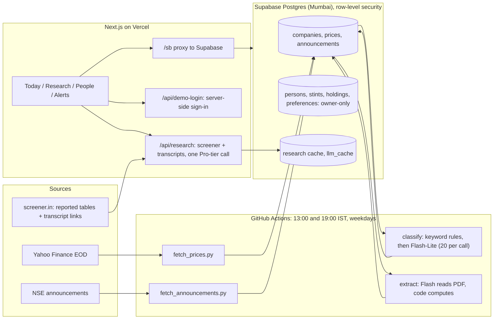

# FINN: Financial Investment Agent

**Live demo:** https://finn-ronav.vercel.app (open on a phone, tap **Enter demo**)

FINN tells an investor what changed in their portfolio, why it matters, and **who in their own network can explain it**.

| Layer | What it does |
|---|---|
| **Push** (Today) | Filings across a 15–20 stock portfolio for a chosen window (24h / 3d / 7d / 30d): alerts from the investor's own rules first, routine paperwork collapsed. Results cards show Revenue / EBITDA / PBT / PAT, QoQ and YoY, and flag one-offs. Management-change cards show the person's background from the filing. |
| **Pull** (Research) | Any NSE symbol: **promised vs delivered** across the last four earnings calls (each verdict with a quote and page link), plus trajectory, balance sheet, cash conversion, guidance and bull/bear. |
| **Network** | Woven into both: "who to call" on every material card and research report, ranked by shared employer, overlapping years, business unit and college; reconnect nudges; a People tab with blind spots and an expertise map. |

**Point of view:** a feed, not a dashboard. The investor sees a few things that matter, and every one ends with a person to call.

## Architecture



## Data pipelines
- **Prices:** `yfinance` end-of-day. A database view (`price_signals`) computes daily % change and volume ÷ 20-day average; the app applies each investor's thresholds.
- **Filings:** NSE's announcements API (BSE blocks scripted access), deduplicated by NSE's own id. Labelled once, never re-labelled.
- **Fundamentals:** screener.in's standardised tables (from company filings) for numbers; earnings-call transcripts for management's words. No news, broker notes or model background knowledge.
- **People:** contacts and career histories (`persons`, `stints`). Names in filings are matched by employer, business unit and college; contact-to-contact links also use overlapping years. Starting point: the investor’s own career (colleges, employers, years) plus a contact list with each person’s employers, titles, tenures, colleges, how they know them, closeness and when they last spoke.

## Models and agents
| Step | Model (tier) | Why |
|---|---|---|
| Label filings | none (rules) → **Gemini 3.5 Flash-Lite** | ~44% are unambiguous and labelled free; the rest go 20 per call (287 filings → 8 calls) |
| Results / management PDFs | **Gemini 4 Hydrogen** (Flash tier), falling back to 3.5 Flash | Reads the first 15 pages only; copies numbers, and **code** computes EBITDA, margins, QoQ/YoY |
| Research | Strongest free-tier model (Pro tier) | One call per company over 4 transcripts + reported numbers; cached 7 days |

Every tier is an ordered list of models with quota-aware retries (it waits as long as Google asks on rate limits, and skips a model that's out of daily quota). Every answer is cached. There are no autonomous agents: each pipeline step is deterministic, and models are used only where reading is needed. Built entirely on the free tier.

## Accuracy
`data/scripts/check_accuracy.py` compares extracted Revenue and PAT with screener.in for the latest quarter.
Non-financial companies: **25/25 figures within 1%**. Overall: 29/34 within 1%, 31/34 within 5%.
The misses are lenders, where we read Total income and total consolidated profit while screener uses
interest earned and profit attributable to shareholders: a definition difference, not a misread.

## Security and privacy
- **Row-level security:** contacts, careers, holdings and alert rules are readable only by their owner's session; the database enforces this, not app code.
- **Secrets stay on the server:** the secret key and Gemini key live in Vercel and GitHub secrets; the browser only has the publishable key. The demo password never reaches the browser.
- **Quota protection:** Research requires a signed-in session. (in this demo anyone can sign in, so the cache is the main guard; production would add per-user rate limits).
- **India network resilience:** browser traffic goes through the app's own domain (`/sb` proxy), because some Indian ISPs have blocked `*.supabase.co`.
- **Real deployment**: contacts are imported only with the investor’s consent (e.g. their own LinkedIn export). Enrichment goes through a licensed provider, and enriched profiles of people outside the network are refreshed or deleted after 90 days. Contacts are deleted immediately when the investor removes them or closes the account. Nothing personal is ever sent to the model except names and career facts needed for a match.

**Data note:** the demo network (31 people) is **synthetic**. No profiles were scraped.

## Cloud
- **Vercel:** app and on-demand research.
- **Supabase (Mumbai):** Postgres, auth, row-level security.
- **GitHub Actions:** scheduled batch jobs. These also keep the free database from pausing.

## Left out, and what's next
**Left out:** phone push notifications (alerts are in-app), voice, full annual-report reading, intraday polling.

**Next:** web push for threshold alerts; annual-report checks (related-party transactions, contingent liabilities, auditor remarks); contact import; a larger accuracy test set; moving network queries into Postgres for large networks.

## Run locally
```
data/      Python pipeline (requirements.txt, scripts/)
supabase/  schema.sql
web/       Next.js app
```
1. Create a Supabase project, run `supabase/schema.sql`, create a demo user.
2. Copy `.env.example` → `.env`; `pip install -r data/requirements.txt`; run `load_seed.py`, `load_symbols.py`, `fetch_prices.py`, `fetch_announcements.py`, `classify_announcements.py`, `extract_details.py`.
3. `cd web`, create `.env.local`, then `npm install && npm run dev`.